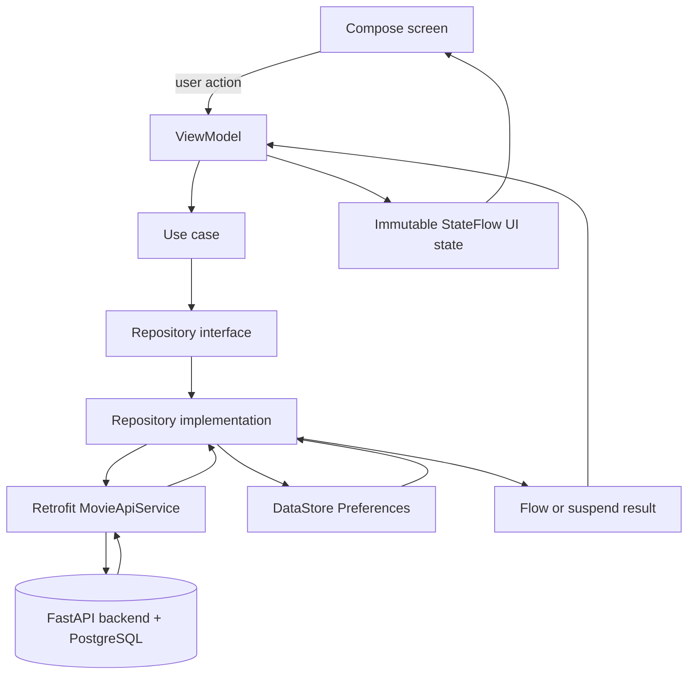

# Architecture

## Overview

Movie Explorer uses a single-module, clean-ish MVVM architecture. The goal is to separate UI state, application actions, domain contracts, and Android data sources while keeping the project small enough to study.



The layers are conventions inside one Gradle module rather than separate Android library modules.

## UI Layer

Feature packages contain route composables, stateless screen composables, UI state, UI models, and ViewModels.

Examples:

- `HomeRoute` obtains `HomeViewModel` through Hilt and collects `uiState` with `collectAsStateWithLifecycle`.
- `HomeScreen` receives `HomeUiState` and callbacks such as `onRefresh` and `onFavoriteClick`.
- `DetailsScreen` renders the sealed `MovieDetailsUiState` without loading data itself.
- `SettingsScreen` sends toggle and language events to `SettingsViewModel` through callbacks.

The screen composables contain rendering and interaction wiring, but no repository, network, or DataStore access.

## ViewModel Layer

Every data-driven feature has a Hilt ViewModel:

- `HomeViewModel` combines an internal loading/refresh/error state with the repository's trending-movie Flow.
- `SearchViewModel` observes its query StateFlow, trims it, debounces for 350 ms, removes duplicate queries, and uses `collectLatest`.
- `DetailsViewModel` exposes loading, success, and error through a sealed interface.
- `MovieFormViewModel` serves both `add_movie` and `edit_movie/{movieId}`: the `movieId` in its `SavedStateHandle` decides the mode. It validates with `MovieFormValidator`, calls `CreateMovieUseCase` or `UpdateMovieUseCase`, and exposes `savedMovieId` so the route navigates once. Unlike the other ViewModels it holds its state in Compose `mutableStateOf`, because a `StateFlow` reaches a `TextField` one frame late and can drop fast keystrokes.
- `FavoritesViewModel` maps the repository's favorites Flow (refreshed from the backend when observed) into `FavoritesUiState`.
- `SettingsViewModel` maps persisted settings (including `movieManagementEnabled`) and sends updates through use cases.
- `SearchViewModel` re-runs its query when the query changes **or** when `observeCatalogVersion()` emits after a create, update, or delete, so results never go stale.
- `MainViewModel` exposes settings at the activity level so dark mode can wrap the full navigation tree.

ViewModels expose `StateFlow` rather than mutable state. Mutable flows remain private where used.

## Domain And Use Case Layer

The domain layer contains Android-independent contracts and models:

- `Movie`
- `UserSettings`
- `ContentLanguage`
- `MovieRepository`
- `SettingsRepository`

Use cases are small classes with `operator fun invoke`. They give ViewModels named application actions and keep repository calls easy to replace in tests.

Movie use cases include trending observation, refresh, search, details, favorite observation, and favorite toggling. Settings use cases include observing settings, updating dark mode, and updating content language.

`RefreshTrendingMoviesUseCase` and `ToggleFavoriteMovieUseCase` convert thrown failures into `MovieExplorerResult`, while Search and Details currently use `runCatching` in their ViewModels. A failed favorite toggle shows Home's inline error message, and Details only flips the heart after the backend confirms.

## Repository Layer

`DefaultMovieRepository` treats the backend as the single source of truth and keeps two in-memory caches:

1. `trendingMovies`: the last `GET movies` result.
2. `favoriteMovies`: the last `GET favorites` result, updated locally after each successful PUT/DELETE.

`observeTrendingMovies()` combines both, so Home favorite icons react to toggles without another request. `refreshTrendingMovies()` loads favorites too, so the icons are correct on first load. `observeFavoriteMovies()` re-fetches favorites whenever a collector starts and keeps the cached list if that request fails. Search and Details use the `isFavorite` value sent by the backend.

`toggleFavorite(movie)` uses the movie's current `isFavorite` to choose `DELETE` or `PUT`. Both are idempotent on the backend, so a retried request cannot flip the state back.

`DefaultSettingsRepository` maps DataStore preferences to `UserSettings` and provides suspend update methods.

## Data Layer And Model Boundaries

The app separates representations by responsibility:

- `MovieDto` / `MovieListResponseDto`: `@Serializable` network representations matching the backend JSON.
- `Movie`: domain representation used by repository contracts and use cases.
- Feature UI models: presentation-ready values such as formatted ratings.

`MovieMappers.kt` converts DTOs to domain models (for example `releaseYear: Int` from the API becomes the display `String` the UI already used). Feature packages convert domain models to their own UI models.

This prevents a database column or API response change from automatically becoming a UI contract change.

## Local Database

Phase 5 removed the Room favorites table: favorites now live on the backend. Reintroducing Room as an offline cache is a roadmap item.

## DataStore Preferences

`DataStoreModule` provides one `DataStore<Preferences>` named `user_settings`.

`DefaultSettingsRepository` reads and writes:

- `dark_mode_enabled` as Boolean.
- `content_language` as a language code.

The dark-mode flow reaches `MainViewModel`, then `MainActivity`, which passes it into `MovieExplorerTheme`. This produces an immediate app-wide theme update.

The content-language value is persisted and displayed, but it is not connected to Android resource localization.

## Network Layer

`MovieApiService` is a Retrofit interface for the Movie Explorer FastAPI backend:

```text
getMovies(search?, limit, offset)   GET    movies
getMovieDetails(id)                 GET    movies/{id}
createMovie(request)                POST   movies
updateMovie(id, request)            PATCH  movies/{id}
deleteMovie(id)                     DELETE movies/{id}
getFavoriteMovies(limit, offset)    GET    favorites
addFavorite(id)                     PUT    favorites/{id}
removeFavorite(id)                  DELETE favorites/{id}
```

`NetworkModule` builds the OkHttp client (timeouts, body logging in debug builds), a `Json` instance with `ignoreUnknownKeys = true`, and Retrofit with the kotlinx.serialization converter. The base URL comes from `BuildConfig.API_BASE_URL`.

`safeApiCall` maps `IOException`, `HttpException`, and `SerializationException` to `MovieExplorerApiException`, whose message is safe to show in the UI. HTTP errors reuse the backend's `detail` text.

## Navigation

`MovieExplorerRoute` defines string routes for Home, Search, Favorites, Settings, About, and Details. Details uses the `details/{movieId}` route pattern and an integer navigation argument.

`MovieExplorerRoot` owns:

- `ModalNavigationDrawer`
- `Scaffold`
- Per-route top app bar titles
- A details back button
- Bottom navigation for Home, Search, and Favorites

Top-level navigation uses `popUpTo`, saved state, `launchSingleTop`, and state restoration. Details is not shown in the bottom bar.

## State Management

State is represented with immutable data classes or a sealed interface:

- `HomeUiState`
- `SearchUiState`
- `FavoritesUiState`
- `SettingsUiState`
- `MovieDetailsUiState`

Long-lived streams use `stateIn` with `SharingStarted.WhileSubscribed(5_000)`. One-off loading operations run in `viewModelScope`.

The project currently does not define a separate one-time effect stream such as `Channel` or `SharedFlow`. Navigation is handled through callbacks from screen routes, and there are no snackbar/toast events that need an effect abstraction.

## Loading, Error, And Empty States

- Home distinguishes initial loading, pull-to-refresh, cached-content refresh error, empty data, and success.
- Search distinguishes empty query, loading, error, no results, and results.
- Details uses loading, success, and error sealed states.
- Favorites has content and empty states.
- Settings renders current persisted values.

Network and server failures are mapped to `MovieExplorerApiException` in the data layer. Exceptions are caught before presentation and converted into user-facing messages in ViewModel state or `MovieExplorerResult`.

## Dependency Injection

Hilt starts at `MovieExplorerApp` with `@HiltAndroidApp`. `MainActivity` is an `@AndroidEntryPoint`, and feature ViewModels use `@HiltViewModel`.

Modules:

- `NetworkModule`: provides `Json`, `OkHttpClient`, `Retrofit`, and `MovieApiService`.
- `DataModule`: binds the movie and settings repository interfaces.
- `DataStoreModule`: provides the settings DataStore.

Constructor injection is used for services, repositories, use cases, and ViewModels.

## End-To-End Examples

Trending refresh:

```text
Pull gesture
  -> HomeViewModel.refresh()
  -> RefreshTrendingMoviesUseCase
  -> DefaultMovieRepository.refreshTrendingMovies()
  -> MovieApiService.getMovies() + getFavoriteMovies() (HTTP)
  -> DTO to domain mapping
  -> in-memory trending StateFlow
  -> HomeViewModel combined StateFlow
  -> HomeScreen grid
```

Favorite toggle:

```text
Favorite button
  -> ToggleFavoriteMovieUseCase
  -> DefaultMovieRepository.toggleFavorite()
  -> PUT or DELETE favorites/{id} (HTTP)
  -> favoriteMovies StateFlow updates
  -> Home and Favorites StateFlows update
  -> Compose recomposes
```

Theme update:

```text
Settings switch
  -> SettingsViewModel
  -> UpdateThemeUseCase
  -> DefaultSettingsRepository
  -> DataStore edit
  -> MainViewModel StateFlow
  -> MainActivity
  -> MovieExplorerTheme
```
