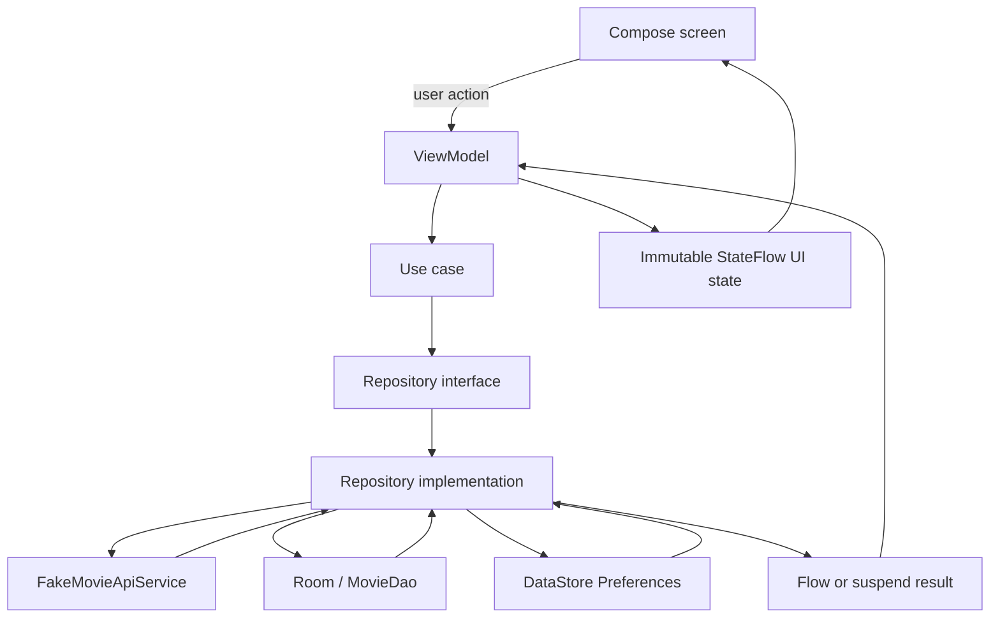

# Architecture

## Overview

Movie Explorer uses a single-module, clean-ish MVVM architecture. The goal is to separate UI state, application actions, domain contracts, and Android data sources while keeping the project small enough to study.



The layers are conventions inside one Gradle module rather than separate Android library modules.

## UI Layer

Feature packages contain route composables, stateless screen composables, UI state, UI models, and ViewModels.

Examples:

- `HomeRoute` obtains `HomeViewModel` through Hilt and collects `uiState` with `collectAsStateWithLifecycle`.
- `HomeScreen` receives `HomeUiState` and callbacks such as `onRefresh` and `onFavoriteClick`.
- `DetailsScreen` renders the sealed `MovieDetailsUiState` without loading data itself.
- `SettingsScreen` sends toggle and language events to `SettingsViewModel` through callbacks.

The screen composables contain rendering and interaction wiring, but no repository, Room, or DataStore access.

## ViewModel Layer

Every data-driven feature has a Hilt ViewModel:

- `HomeViewModel` combines an internal loading/refresh/error state with the repository's trending-movie Flow.
- `SearchViewModel` observes its query StateFlow, trims it, debounces for 350 ms, removes duplicate queries, and uses `collectLatest`.
- `DetailsViewModel` exposes loading, success, and error through a sealed interface.
- `FavoritesViewModel` maps the Room-backed favorites Flow into `FavoritesUiState`.
- `SettingsViewModel` maps persisted settings and sends updates through use cases.
- `MainViewModel` exposes settings at the activity level so dark mode can wrap the full navigation tree.

ViewModels expose `StateFlow` rather than mutable state. Mutable flows remain private where used.

## Domain And Use Case Layer

The domain layer contains Android-independent contracts and models:

- `Movie`
- `UserSettings`
- `ContentLanguage`
- `MovieRepository`
- `SettingsRepository`

Use cases are small classes with `operator fun invoke`. They give ViewModels named application actions and keep repository calls easy to replace in tests.

Movie use cases include trending observation, refresh, search, details, favorite observation, and favorite toggling. Settings use cases include observing settings, updating dark mode, and updating content language.

`RefreshTrendingMoviesUseCase` converts thrown failures into `MovieExplorerResult`, while Search and Details currently use `runCatching` in their ViewModels.

## Repository Layer

`DefaultMovieRepository` coordinates three kinds of movie state:

1. Fake remote DTOs from `MovieApiService`.
2. An in-memory `MutableStateFlow` cache for trending movies.
3. Room rows and favorite IDs from `MovieDao`.

The repository combines trending movies with Room favorite IDs, so Home favorite icons react to database changes. Search also checks Room IDs before mapping results. Details resolves data in this order:

```text
In-memory trending movie
  -> saved Room favorite
  -> fake API details request
```

`DefaultSettingsRepository` maps DataStore preferences to `UserSettings` and provides suspend update methods.

## Data Layer And Model Boundaries

The app separates representations by responsibility:

- `MovieDto`: fake remote/network representation.
- `MovieEntity`: Room schema representation.
- `Movie`: domain representation used by repository contracts and use cases.
- Feature UI models: presentation-ready values such as formatted ratings.

`MovieMappers.kt` converts DTOs and entities to domain models and domain models to entities. Feature packages convert domain models to their own UI models.

This prevents a database column or API response change from automatically becoming a UI contract change.

## Room Database

`MovieExplorerDatabase` is a version 1 Room database containing `MovieEntity` rows in `favorite_movies`.

`MovieDao` supports:

- Observing all favorites ordered by title.
- Observing favorite IDs.
- Checking whether one ID is a favorite.
- Reading one saved movie.
- Upserting a favorite.
- Deleting a favorite by ID.

The complete movie is stored, not only its ID. That is why Favorites can render saved data offline. Genres are stored as a pipe-delimited string and reconstructed by the mapper.

Room does not cache the trending list, and schema export is currently disabled.

## DataStore Preferences

`DataStoreModule` provides one `DataStore<Preferences>` named `user_settings`.

`DefaultSettingsRepository` reads and writes:

- `dark_mode_enabled` as Boolean.
- `content_language` as a language code.

The dark-mode flow reaches `MainViewModel`, then `MainActivity`, which passes it into `MovieExplorerTheme`. This produces an immediate app-wide theme update.

The content-language value is persisted and displayed, but it is not connected to Android resource localization.

## Fake Network Layer

`MovieApiService` defines Retrofit-style suspend functions without depending on Retrofit:

```text
getTrendingMovies()
searchMovies(query)
getMovieDetails(id)
```

`FakeMovieApiService` implements the interface with eight hard-coded DTOs, deterministic image URLs, coroutine delays, title/genre filtering, and an optional error flag through `NetworkConfig`.

Replacing it with a real backend would mainly require a new `MovieApiService` implementation and a changed Hilt binding.

## Navigation

`MovieExplorerRoute` defines string routes for Home, Search, Favorites, Settings, About, and Details. Details uses the `details/{movieId}` route pattern and an integer navigation argument.

`MovieExplorerRoot` owns:

- `ModalNavigationDrawer`
- `Scaffold`
- Per-route top app bar titles
- A details back button
- Bottom navigation for Home, Search, and Favorites

Top-level navigation uses `popUpTo`, saved state, `launchSingleTop`, and state restoration. Details is not shown in the bottom bar.

## State Management

State is represented with immutable data classes or a sealed interface:

- `HomeUiState`
- `SearchUiState`
- `FavoritesUiState`
- `SettingsUiState`
- `MovieDetailsUiState`

Long-lived streams use `stateIn` with `SharingStarted.WhileSubscribed(5_000)`. One-off loading operations run in `viewModelScope`.

The project currently does not define a separate one-time effect stream such as `Channel` or `SharedFlow`. Navigation is handled through callbacks from screen routes, and there are no snackbar/toast events that need an effect abstraction.

## Loading, Error, And Empty States

- Home distinguishes initial loading, pull-to-refresh, cached-content refresh error, empty data, and success.
- Search distinguishes empty query, loading, error, no results, and results.
- Details uses loading, success, and error sealed states.
- Favorites has content and empty states.
- Settings renders current persisted values.

The fake service throws internally. Exceptions are caught before presentation and converted into user-facing messages in ViewModel state or `MovieExplorerResult`.

## Dependency Injection

Hilt starts at `MovieExplorerApp` with `@HiltAndroidApp`. `MainActivity` is an `@AndroidEntryPoint`, and feature ViewModels use `@HiltViewModel`.

Modules:

- `DataModule`: binds fake API, movie repository, and settings repository interfaces.
- `DatabaseModule`: provides the Room database and DAO.
- `DataStoreModule`: provides the settings DataStore.

Constructor injection is used for services, repositories, use cases, and ViewModels.

## End-To-End Examples

Trending refresh:

```text
Pull gesture
  -> HomeViewModel.refresh()
  -> RefreshTrendingMoviesUseCase
  -> DefaultMovieRepository.refreshTrendingMovies()
  -> FakeMovieApiService.getTrendingMovies()
  -> DTO to domain mapping
  -> in-memory trending StateFlow
  -> HomeViewModel combined StateFlow
  -> HomeScreen grid
```

Favorite toggle:

```text
Favorite button
  -> ToggleFavoriteMovieUseCase
  -> DefaultMovieRepository.toggleFavorite()
  -> MovieDao upsert/delete
  -> Room Flow emits
  -> Home and Favorites StateFlows update
  -> Compose recomposes
```

Theme update:

```text
Settings switch
  -> SettingsViewModel
  -> UpdateThemeUseCase
  -> DefaultSettingsRepository
  -> DataStore edit
  -> MainViewModel StateFlow
  -> MainActivity
  -> MovieExplorerTheme
```
